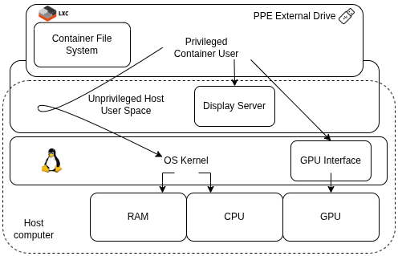
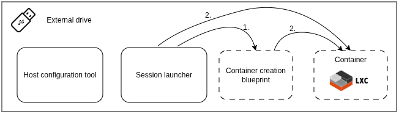
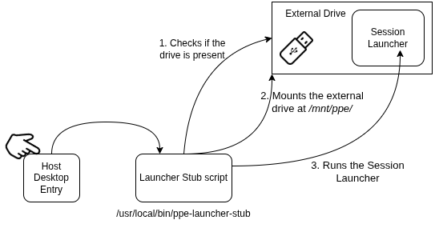
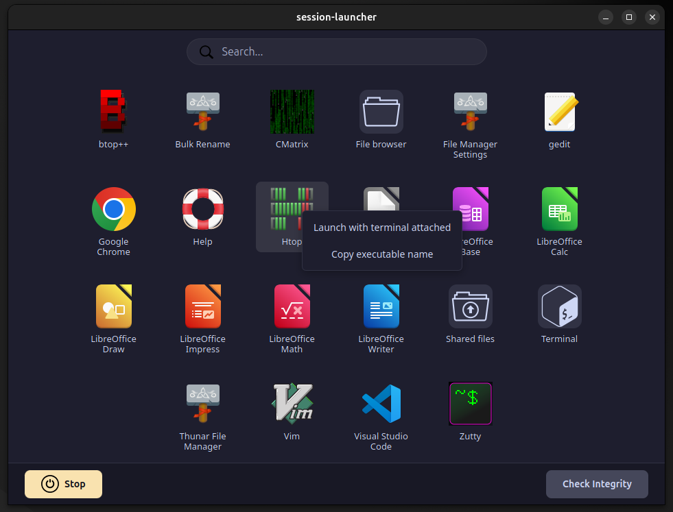
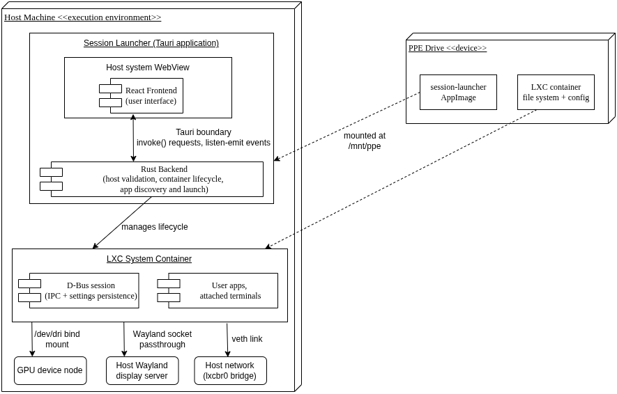

# Portable Personal Environment (PPE)

**Portable Personal Environment (PPE)** is a self-contained, encrypted Linux computing environment that lives on an external drive and executes natively within the unprivileged user space of any pre-configured Linux host. 

Designed to solve the portability and security limitations of shared computers, PPE bridges the gap between Live USBs and Cloud VMs, providing seamless integration and a comprehensive suite of utilities. 

By building on **LXC system containers** and kernel user namespaces (UID/GID translation), it allows users to retain full `root` and package-management privileges inside their personal container while running completely unprivileged on the host machine. 

The environment reuses the host's kernel, Wayland display server, and integrated GPU, delivering near-native performance with zero hypervisor overhead.

<p align="center">
  
</p>

---

## Tech Stack

* **Virtualization & Isolation:** LXC (Linux Containers), Linux Kernel Namespaces (UID/GID translation), POSIX ACLs
* **Host Configuration Tool:** Rust (statically linked with `musl`), Bash, `systemd` (mount/automount units), `udev`
* **Session Launcher:** Tauri 2, Rust (Backend), React + Vite (Frontend), packaged as a portable **AppImage**
* **Graphics & Session Bridging:** Wayland socket passthrough, Linux DRM/DRI (`/dev/dri`) for hardware GPU acceleration, D-Bus & `dconf` (settings persistence)

---

## Validation & Brief Results

Functionality and near-native performance (`sysbench`, `glmark2`, `lmbench`, `hyperfine`) were verified using a single PPE drive across heterogeneous hardware and desktop environments running **Ubuntu 24.04 (GNOME)** and **Kubuntu 24.04 (KDE Plasma)** — demonstrating seamless adaptation between different host utilities:

* **Lenovo ThinkPad T480s & ThinkPad T14 Gen 1:** The baseline portability benchmarks, confirming near-zero CPU, GPU and syscall overhead compared to native host execution.
* **HP ZBook Fury 15 G7:** Successfully connected exclusively to the integrated Intel GPU for hardware-accelerated rendering while cleanly ignoring the dedicated NVIDIA Quadro RTX 3000 Mobile GPU, operating within the intended scope boundaries.
* **Apple MacBook Air (2015):** Successfully inherited the host's custom kernel-level networking drivers without requiring in-container driver configuration.

---

## System Functionality & Architecture

<p align="center">
  
</p>

The system is divided based on privilege into two complementary components shipped directly on the external drive:

### 1. The Host Configuration Tool
A privileged, idempotent CLI tool written in Rust and compiled statically. It is run once by an administrator (or device owner) to prepare a host computer for PPE use. 

It installs LXC prerequisites, configures unprivileged networking and GPU access rules, sets up lazy on-demand mounting at `/mnt/ppe`, and registers a system-wide desktop entry pointing to a lightweight launch stub script.

<p align="center">
  
</p>

👉 **[Read the Host Configuration Tool README](./host-configuration/README.md)**

### 2. The Session Launcher & External Drive
An unprivileged Tauri (Rust + React) desktop application residing on the external drive as a self-contained AppImage. 

Invoked seamlessly by the host desktop entry mechanism, it verifies host integrity, manages the LXC container's lifecycle and bridges the host's Wayland display and GPU sockets.

It also abstracts complex container commands behind an intuitive GUI application grid with live application discovery, an integrated terminal, and a bidirectional `/Shared` file-transfer folder.

<p align="center">
  
  
</p>

👉 **[Read the Session Launcher README](./session-launcher/README.md)**

---

## How to Run (Quick Start)

1. **Build the Components (Optional if using prebuilt binaries):**
   * **Host Configurator:**
     ```bash
     cd host-configuration
     rustup target add x86_64-unknown-linux-musl
     cargo build --release --target x86_64-unknown-linux-musl
     ```
   * **Session Launcher:**
     ```bash
     cd session-launcher
     npm install
     npm run tauri build
     ```

2. **Prepare the External Drive:** Format an external drive as `ext4`, enable full-disk **LUKS** encryption, set the filesystem label strictly to `PPE`, and copy the compiled `host-configuration` binary and `session-launcher` AppImage onto the root of the drive.
3. **Configure a Host (One-Time Setup):** Plug in and unlock the drive, then run the configuration tool with root privileges and select the target host user account:
   ```bash
   sudo /media/<user>/PPE/host-configuration
   ```
   Then remove the drive.

    *(Note: Following this initial setup, the drive will not be mounted by default and will only be accessible via the custom application entry)*
4. **Launch the Environment (Everyday Use):** Plug in the drive, enter the LUKS decryption passphrase, and open **PPE Launcher** from the host's application menu.

    *(Note: On first run, the launcher will guide you through selecting a container Linux distribution and creating your personal unprivileged user account.)*

---

## Deep Dive & Official Documentation

For a complete analysis of the theoretical foundation, security threat modeling, implementation details, and full benchmark results, refer to the official Bachelor's Thesis documentation:

📄 **[Portable Personal Environment - Full Bachelor's Thesis (PDF)](./docs/Tofan_George_thesis.pdf)**