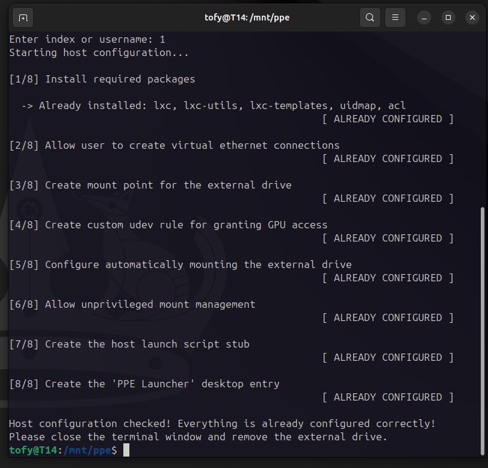

# Host Configuration Tool

The **Host Configuration Tool** is the privileged CLI component of the Portable Personal Environment (PPE), written in Rust and statically linked against `musl`. Because all dependencies are baked into a single portable binary, it runs with zero external requirements across compatible Linux hosts.

Its primary purpose is to perform the one-time system-wide and per-user setup required on a host computer so that any PPE drive can subsequently be mounted and executed entirely unprivileged.

Both its configuration flow and its uninstallation flow (`--remove`) are **strictly idempotent**. Every task inspects the current host state against expected template constants before acting, skipping steps that are already in place and aborting the pipeline immediately if an error occurs. Re-running the tool therefore doubles as a non-destructive self-validation check, while the removal mode cleanly reverses all PPE host modifications.

The tool also identifies the host system distribution and performs variations of each step accordingly.

*(Note: Only Ubuntu 24.04 and its flavours are currently supported, but extension to other distros is seamless through the existing structure)*

---

## Configuration Pipeline

After passing three initial gating checks—verifying `root` privileges (`geteuid`), confirming a supported distribution family via `/etc/os-release`, and prompting the operator to select a regular target user (`UID 1000–65533`)—the orchestrator executes an 8-step pipeline:

1. **Install Prerequisites:** Queries the package database and non-interactively installs missing dependencies (`lxc`, `lxc-utils`, `lxc-templates`, `uidmap`, and `acl`).
2. **Permit Unprivileged Networking:** Appends `<user> veth lxcbr0 10` to `/etc/lxc/lxc-usernet`, authorizing the target user to attach virtual ethernet interfaces to the host network bridge without root rights.
3. **Prepare the Mount Point:** Creates `/mnt/ppe`, assigns ownership to the selected host user, and sets `o+x` traversal permissions so the container's mapped UIDs can reach the filesystem.
4. **Grant GPU Access:** Installs `/etc/udev/rules.d/99-lxc-gpu.rules` and triggers `udev` to grant the container's mapped identities POSIX ACL read/write access to the host's `/dev/dri` rendering devices.
5. **Establish On-Demand Mounting:** Suppresses the desktop environment's default automounter via `udev` and registers lazy `systemd` `.mount` and `.automount` units keyed to the `PPE` filesystem label.
6. **Grant Unprivileged Mount Control:** Creates a restricted sudoers drop-in (`/etc/sudoers.d/99-ppe-mount` with `440` permissions) allowing passwordless `systemctl start`, `stop`, and `reset-failed` strictly on the PPE mount units.
7. **Install the Launch Stub:** Writes the tamper-protected Bash intermediary script to `/usr/local/bin/ppe-launcher-stub` (`755`), which verifies drive presence, mounts `/mnt/ppe`, and invokes the Session Launcher.
8. **Register the Desktop Entry:** Creates `/usr/share/applications/ppe-launcher.desktop` (`644`) and refreshes the desktop database so **PPE Launcher** appears in the host's application menu.

<p align="center">
  
</p>

---

## Usage & Commands

### Build from Source (Optional)
```bash
rustup target add x86_64-unknown-linux-musl
cargo build --release --target x86_64-unknown-linux-musl
```


### 1. Configure a Host
Plug in the drive and execute the binary with `sudo` from the default removable media path, then select the target user by index or username:
```bash
sudo /media/<user>/PPE/host-configuration
```

### 2. Verify Existing Configuration
Once configured, opening **PPE Launcher** mounts the drive at `/mnt/ppe`. Re-running the tool verifies that all 8 steps report `[ ALREADY CONFIGURED ]`:
```bash
sudo /mnt/ppe/host-configuration
```

### 3. Remove Configuration (Uninstall)
To cleanly stop active mounts and remove all generated rules, units, scripts, and permissions (while leaving system packages intact):
```bash
sudo /mnt/ppe/host-configuration --remove
```

### 4. Help Menu
Can be inspected without root privileges:
```bash
./host-configuration --help
```

---

## Deep Dive & Official Documentation

For further architectural and implementation details on the Host Configuration Tool, consult the official Bachelor's Thesis documentation:

📄 **[Portable Personal Environment - Full Bachelor's Thesis (PDF)](../docs/Tofan_George_thesis.pdf)**
* **Chapter 4.2** — *The Host Configuration Tool* (Initial checks, configuration flow, removal flow, and idempotency)
* **Chapter 4.4** — *Integration in the Linux Filesystem* (Host-side filesystem conventions and configuration footprint)
* **Chapter 5.4** — *The Configuration Tool* (Static `musl` compilation, `Task`/`DistroFamily` data modeling, CLI orchestration, and step-by-step implementation)
* **Chapter 6.1** — *Self-Validation Through Re-Execution* (Idempotent verification of setup and removal)
* **Chapter 7.4** — *User's Manual: Host Configuration* (Administrator setup and uninstallation guide)