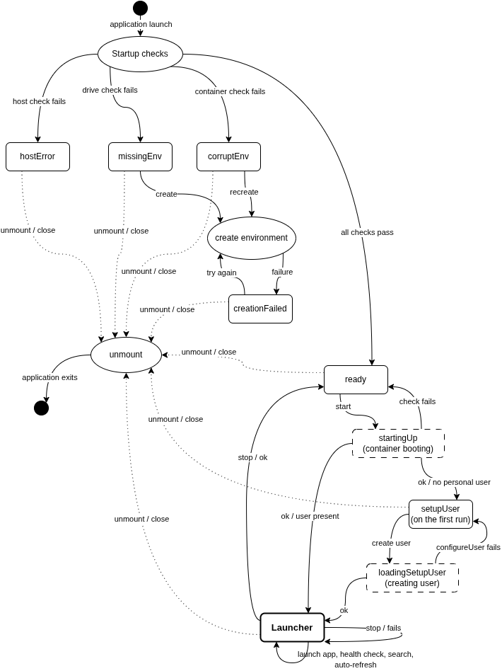
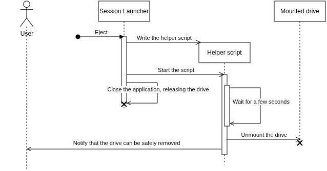

# Session Launcher

The **Session Launcher** is the unprivileged, user-facing component of the Portable Personal Environment (PPE). Distributed as a self-contained portable **AppImage**, it runs directly from the external drive without requiring any installation on the host. 

Its primary purpose is to manage the complete lifecycle of the LXC system container — from its initial creation and boot-up to a safe shutdown — while abstracting the complex underlying container execution commands behind an intuitive graphical interface.

**Tech Stack:** 
* **Framework:** Tauri 2
* **Backend:** Rust (handles host validation, container lifecycle, application discovery, and system/hardware bridging)
* **Frontend:** React + Vite (manages the UI state machine and application grid)

---

## Flow of Startup Events

The application orchestrates the container's lifecycle using a strict state machine (`viewState`). Before reaching the main application grid, it guarantees a safe environment by sequentially verifying host integrity, checking container existence/health, booting the LXC container, and ensuring a personal unprivileged user is configured. 

  

---

## The Unmount Mechanism

Safely unmounting the drive presents a self-referential challenge: the Session Launcher cannot unmount the drive it is currently executing from. 

To solve this, the launcher uses a delegated unmount mechanism. It writes a temporary helper script to the host, spawns it as a detached process, and immediately closes itself to release the drive lock. The helper script waits briefly, performs the unmount, and triggers a system-wide desktop notification to inform the user that the drive is safe to remove.

  

---

## Ease of Use & Core Features

The launcher integrates several features to make working inside the container feel like a native desktop experience:

* **Bidirectional File Transfer (`/Shared`):** A dedicated directory configured with POSIX default and access ACLs (`setfacl -d`). This creates a seamless, bidirectional read/write drop zone between the host and the container without permission conflicts.
* **Host-Native Terminal & File Browser Integration:** The Rust backend uses lazy singletons (`TerminalManager` and `FileManager`) to probe and cache the host's default utilities (e.g., GNOME Terminal, Konsole, Nautilus). This allows users to open container directories or launch CLI applications using familiar host windows.
* **Live Application Discovery:** The backend recursively watches the container's `.desktop` application directories using the `notify` crate. The React grid updates automatically as packages are installed or removed via the container's package manager, and dynamically injects Wayland Ozone flags for Chromium/Electron-based apps.
* **Automated Runtime Diagnostics:** A built-in health check probes the live environment to ensure the host-container bridge is fully functional, verifying Wayland socket writability, `/dev/dri` GPU node passthrough, IPv4 network reachability, and in-container `systemd` health.

---

## Deep Dive & Official Documentation

For a detailed breakdown of the backend module decomposition, UI state machine, and IPC bridging, consult the official Bachelor's Thesis documentation:

📄 **[Portable Personal Environment - Full Bachelor's Thesis (PDF)](../docs/Tofan_George_thesis.pdf)**
* **Chapter 4.3** — *The Session Launcher* (Startup phases, host-container bridging, UI structure, and the unmount mechanism)
* **Chapter 5.5** — *The Session Launcher* (Backend implementation: Tauri managed state, `TerminalManager`, central LXC execution layer, live discovery, and D-Bus session generation)
* **Chapter 5.6** — *The Launcher Frontend* (React command bridge, uniform result contracts, and the view state machine)
* **Chapter 6.2** — *Automated Runtime Tests* (Implicit host integrity checks and runtime diagnostic implementation)
* **Chapter 7.5** — *User's Manual: Using the Environment* (End-user guide to the GUI, application launching, and safe shutdown)